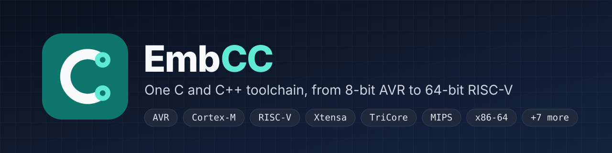
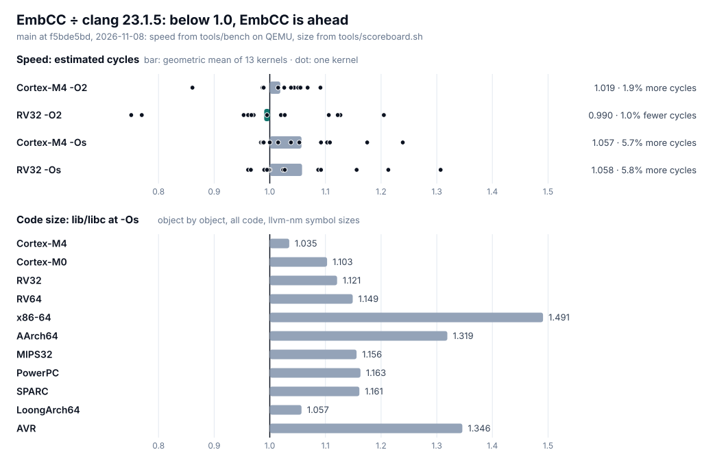
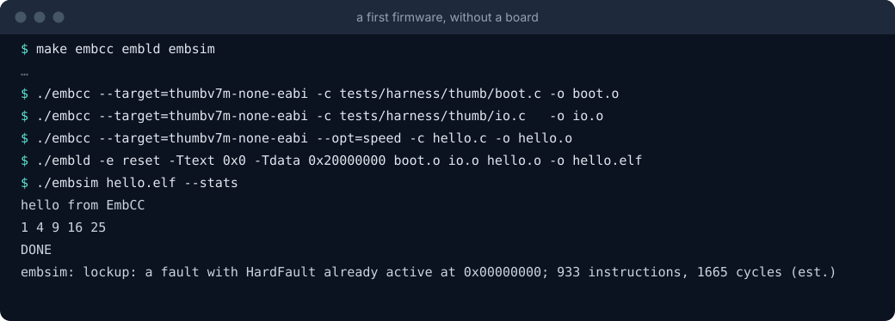

[](https://github.com/EmbLinkOs/EmbCC/actions/workflows/ci.yml)
[](LICENSE)
[](https://emblinkos.github.io/EmbCC/)
[](https://github.com/EmbLinkOs/EmbCC/releases)

**EmbCC is a C and C++ compiler for embedded systems, with the rest of
the toolchain built in: an assembler, a linker, a debugger, a simulator
and a flash programmer.** One `embcc` binary targets every chip in the
table below, from an 8-bit AVR to a 64-bit RISC-V, and it preprocesses,
compiles, assembles and links without starting any other program.

> **Status: beta.** The current release is 0.1.0 (November 2026). CI
> builds and tests every pull request on QEMU and EmbSim; no real board is
> part of CI yet. What 1.0 will promise, and how far each promise is
> today, is in the [roadmap](docs/roadmap.md).

## Why EmbCC

- **One toolchain, many targets.** Every family in [Targets](#targets),
  from AVR and Cortex-M to TriCore, RX and LoongArch, is one `--target=`
  away. There is no separate cross-compiler, assembler or linker to
  install for each.
- **No dependencies.** The whole toolchain is ISO C99. A C compiler and
  `make` build it, and CI builds it with only the ISO C host layer
  ([`build (PLATFORM=iso)`](.github/workflows/ci.yml)). EmbCC compiles
  its own sources, warning-free (`make check-self`, also in CI).
- **Checked, not assumed.** For each target, the programs of
  [`tests/exec`](tests/exec) (396 of them) run on QEMU at `-O0`, `-O1`,
  `-O2` and `-Os`, and each must exit as the program says. A program
  that cannot apply to a target is listed in that target's suite, with
  the reason; for example, see
  [`xtensa-exec.sh`](tests/golden/xtensa-exec.sh). On the host, each
  program is also built with GCC, and both builds must agree
  ([`agrees-with-gcc.sh`](tests/golden/agrees-with-gcc.sh)). Encoders are
  compared byte for byte with llvm-mc or GNU as. Every pull request runs
  150 random programs ([`verify/fuzz`](verify/fuzz)) on x86-64, Cortex-M4,
  Cortex-M0, RV32 and RV64, at `-O2`, `-O3` and `-Os`, and GCC's torture
  suite runs nightly ([`nightly.yml`](.github/workflows/nightly.yml)).
- **It refuses rather than guesses.** A construct EmbCC cannot compile
  correctly is an error that names it, never code that does something
  else. [What each target compiles](docs/manual/limits.md) lists every
  refusal, target by target, and a test checks each entry against the
  compiler.
- **Firmware runs without a board.** EmbSim simulates Cortex-M, RISC-V,
  AVR, MIPS, PIC32 and PIC24/dsPIC boards with deterministic time,
  estimated cycles, coverage, profiles and a GDB server
  ([Debugging](docs/manual/debugging.md)).

## How it compares with clang



Every number is EmbCC ÷ clang, so below 1.00 EmbCC is ahead. The
reference is clang 23.1.5, because one clang builds for most of EmbCC's
targets. Both runs are on `main` at f5bde5bd, 2026-11-08.

- **Speed is close to clang's at `-O2`, and behind at `-Os`.** On
  Cortex-M4, EmbCC's code takes 1.9% more estimated cycles than clang's
  at `-O2`. On RV32 it takes 1.0% fewer. At `-Os` it takes 5.7% and
  5.8% more. Across the 13 kernels, the range is from 25% fewer (RV32
  crc) to 31% more (RV32 fixed point at `-Os`). Cycles are estimates
  from [tools/bench](tools/bench)'s cost table, not measured on silicon.
- **Code is larger than clang's on every target measured.** For the C
  library at `-Os`, compared object by object, EmbCC's code is 3.5%
  larger on Cortex-M4 and 5.7% on LoongArch64. It is 10 to 16% larger
  on Cortex-M0, RISC-V, MIPS, PowerPC and SPARC, and furthest behind on
  AVR (1.35×), AArch64 (1.32×) and x86-64 (1.49×). Much of the gap is in
  the math library. Without it, EmbCC is just ahead on Cortex-M4, RV32
  and RV64 (0.991 to 0.998), and x86-64 falls to 1.26×.
- **Compile time.** Compiling the C library one file at a time
  takes EmbCC 0.31× clang's time (2.9 s against 9.2 s). For EmbCC's own
  sources, it takes 1.08× (25.0 s against 23.3 s).

The two runs are saved as they were printed:
[speed](tools/bench/results/2026-11-08.txt) and
[size, compile time and refusals](tools/bench/results/2026-11-08-scoreboard.md).

To reproduce the measurements, run `sh tools/scoreboard.sh`. The
[scoreboard](docs/internals/scoreboard.md) explains the method and keeps
the history.

## A first firmware, without a board



The program below runs on a Cortex-M3. Its startup code and output
functions come from the test harness. Build the three tools you need
with `make embcc embld embsim`, then save this as `hello.c`:

```c
void puts_(const char *s);
void putn(long v);

static int square(int x) { return x * x; }

int main(void)
{
    puts_("hello from EmbCC\n");
    for (int i = 1; i <= 5; i++)
        putn(square(i));
    puts_("\nDONE\n");
    return 0;
}
```

```sh
T=--target=thumbv7m-none-eabi
./embcc $T -c tests/harness/thumb/boot.c -o boot.o
./embcc $T -c tests/harness/thumb/io.c   -o io.o
./embcc $T --opt=speed -c hello.c                -o hello.o
./embld -e reset -Ttext 0x0 -Tdata 0x20000000 boot.o io.o hello.o -o hello.elf
./embsim hello.elf --stats
```

```text
hello from EmbCC
1 4 9 16 25 
DONE
embsim: lockup: a fault with HardFault already active at 0x00000000; 933 instructions, 1665 cycles (est.)
```

When `main` returns, the harness's startup code traps, and EmbSim stops
there. The same image runs on QEMU's `lm3s6965evb`, and on a board once
the link layout matches the part. Other boards and families, with a
startup file, a linker script and a C library, are in
[Getting started](docs/manual/getting-started.md).

## Targets

| Family | `--target=` | C | C++ | Assembler | Simulator |
|---|---|---|---|---|---|
| Arm Cortex-M (M0/M0+, M3, M4/M4F, M7, M23, M33) | `thumbv6m-none-eabi`, `thumbv7m-none-eabi`, `thumbv7em-none-eabi[hf]`, `thumbv8m.base-none-eabi`, `thumbv8m.main-none-eabi[hf]` | yes | yes¹ | yes, with DSP and TrustZone-M | EmbSim |
| Arm Cortex-A/R (ARMv7-A) | `armv7a-none-eabi[hf]` | yes | yes¹ | yes | |
| RISC-V (RV32/RV64 IMAC, F and D) | `riscv32-unknown-elf`, `riscv64-unknown-elf` | yes | yes¹ | yes | EmbSim |
| AVR (ATmega) | `avr` | yes | | yes | EmbSim |
| Xtensa (ESP32 class, windowed ABI) | `xtensa-none-elf` | yes | yes¹ | yes | |
| Infineon TriCore (AURIX) | `tricore-none-elf` | yes | yes¹ | yes | |
| Renesas RX | `rx-none-elf` | yes | yes¹ | yes | |
| NXP ColdFire | `m68k-none-elf` | yes | yes¹ | yes | |
| MIPS32 and MIPS64, both byte orders | `mipsel-none-elf`, `mips-none-elf`, `mips64el-none-elf`, `mips64-none-elf` | yes | yes¹ | yes | EmbSim (MIPS32, PIC32) |
| PowerPC (e500, 32-bit) | `powerpc-none-eabi` | yes | yes¹ | yes | |
| SPARC V8 (LEON3) | `sparc-none-elf` | yes | yes¹ | yes | |
| LoongArch64 | `loongarch64-none-elf` | yes | yes¹ | yes | |
| x86-64 and AArch64: bare metal, EmbLinkOS | `x86_64-elf`, `aarch64-elf`, `x86_64-emblink`, `aarch64-emblink` | yes | yes | yes (x86-64: NASM syntax) | |
| Linux, macOS, Windows | `x86_64-linux-gnu`, `aarch64-linux-gnu`, `x86_64-apple-darwin`, `aarch64-apple-darwin`, `x86_64-windows-gnu` | yes | yes | | |

¹ With `-fno-exceptions`: there are no unwind tables for these targets
yet, so exceptions are refused by name.

**What "yes" means.** A target is listed when its code is run, not just
compiled: every embedded family above has an execution suite in
[`tests/golden`](tests/golden) that runs `tests/exec` on QEMU at four
optimization levels, and CI runs every suite on each pull request
([`ci.yml`](.github/workflows/ci.yml), the `suite` jobs). What
a target does not support is refused by name, and is listed in
[What each target compiles](docs/manual/limits.md). Each target's ABI,
options and limitations are in [Targets](docs/manual/targets.md). An
unknown `--target=` lists every triple EmbCC accepts. EmbSim's boards
(`embsim --help`) are in [Boards](docs/manual/boards.md).

## The tools

| Tool | What it does |
|---|---|
| `embcc` | The compiler: C (C89 to C23 with GNU extensions) and C++, plus GCC-compatible command lines |
| `embas` | The assembler, for GNU-syntax `.s` and `.S` files on every embedded target |
| `embld` | The linker: GNU linker scripts, `--gc-sections`, map files, long-branch and TrustZone veneers |
| `embdbg` | The debugger: symbols, source lines, fault dumps, and live debugging through the GDB remote protocol |
| `embsim` | The simulator: runs firmware without a board, with deterministic time and cycle estimates |
| `embflash` | Programs a target's flash through a GDB server (OpenOCD, pyOCD, J-Link, Black Magic Probe, QEMU) |
| `embtrace` | Function-level tracing on the target: call counts, times, a call tree, Perfetto traces |
| `embmap` | Where the bytes went: sections, symbols and regions of a firmware image |
| `embpack` | Turns a linked image into what a programmer or bootloader takes: raw binary, Intel HEX, S-records or UF2, with a CRC |
| `embrt` | The worst-case stack depth of a firmware, proved from its call graph |
| `embsvd` | From a vendor's SVD file: the device header, a startup file and a linker script, or the registers as JSON |
| `embread`, `embls`, `embidx`, `embar` | ELF reader, language server, cross-unit interface index, archiver |

## Building and installing

A release installs on Linux and macOS, x86-64 and arm64:

```sh
curl -fsSL https://raw.githubusercontent.com/EmbLinkOs/EmbCC/main/install.sh | sh
```

The script installs the latest release into `~/.local` (`/usr/local` as
root), after checking the download's SHA-256. The `.deb` packages and the
script's options are described in
[Installing](docs/manual/getting-started.md#installing); the Homebrew tap
is not published yet.

From a source checkout:

```sh
make           # the compiler, every tool and every target's runtime
make embdbg    # the debugger
make check     # compile and run every program in tests/exec and tests/cxx
make install   # into PREFIX (default /usr/local)
```

`make all` builds the tools alone. To build the compiler and runtimes for
the targets you use only, as a GCC cross compiler is built for one, name
their families: `make TARGETS="arm riscv"`, or `./configure
--targets=arm,riscv` to remember the choice
([Choosing the targets](docs/manual/getting-started.md#choosing-the-targets)).
The runtime and C library for each board, and the test suites, are
described in [Getting started](docs/manual/getting-started.md).

## Operating systems and hosted programs

EmbCC is also a compiler for operating systems and hosted programs:
x86-64 and AArch64 kernels (EmbLinkOS among them), and Linux, macOS and
Windows objects. With no `--target=`, it compiles for the machine it
runs on, as GCC and clang do:

```sh
./embcc -O2 hello.c -o hello && ./hello
```

On Linux that is a static executable against EmbCC's own C library,
which `make` builds. On macOS it is a Mach-O program linked by the
system linker. A board or a kernel is always named with `--target=`.

`x86_64-elf` and `aarch64-elf` build freestanding kernels; `embld
--embx` writes EmbLinkOS images.

## Documentation

The manual is published at
**[emblinkos.github.io/EmbCC](https://emblinkos.github.io/EmbCC/)**, and
its sources are in [docs/](docs/README.md).

- [Getting started](docs/manual/getting-started.md): building,
  installing, and first programs on each family of boards.
- [Options](docs/manual/options.md) and
  [Migrating from GCC](docs/manual/migrating-from-gcc.md): EmbCC's own
  option names, and the GCC spellings it accepts.
- [Targets](docs/manual/targets.md) and
  [What each target compiles](docs/manual/limits.md): ABIs, options and
  refusals, per target.
- [Roadmap](docs/roadmap.md): what 1.0.0 will promise, and the releases
  on the way there.
- [Security](SECURITY.md): how to report a vulnerability privately, and
  what counts as one.

## Contributing

New contributors are welcome. Some ways in:

- Pick an issue labelled
  [good first issue](https://github.com/EmbLinkOs/EmbCC/issues?q=is%3Aissue+is%3Aopen+label%3A%22good+first+issue%22):
  each one names the files involved and says when it is done.
- Ask a question or share an idea in
  [Discussions](https://github.com/EmbLinkOs/EmbCC/discussions).
- Report wrong code or a compiler error with the
  [issue templates](https://github.com/EmbLinkOs/EmbCC/issues/new/choose).
  A program that EmbCC compiles into code that does something else is
  the most urgent kind of bug there is.

[CONTRIBUTING.md](CONTRIBUTING.md) says where to start, and the
[contributor's guide](docs/internals/contributing.md) has the rules and
the tests a change needs.

## The EmbLink family

EmbCC is one of the projects of [EmbLinkOs](https://github.com/EmbLinkOs):

- **[EmbLinkRTOS](https://github.com/EmbLinkOs/EmbLinkRTOS)**: a
  deterministic real-time kernel for microcontrollers, from AVR to
  Cortex-M, RISC-V and ESP32. EmbCC is one of the compilers it is built
  with.
- **[EmbSIM](https://github.com/EmbLinkOs/EmbSIM)**: an electronics and
  embedded-systems simulator, in which real microcontrollers run
  unmodified firmware in schematics and circuits.
- **[EmbLinkOS](https://github.com/EmbLinkOs/EmbLinkOs)**: an operating
  system, compiled by EmbCC.

## License

EmbCC is licensed under the [Apache License, Version 2.0](LICENSE).
[NOTICE](NOTICE) names the code by others it includes, under their own
permissive notices: Sun's fdlibm and FreeBSD's complex functions in the
C library's math, and the GDB target descriptions EmbSim serves.
